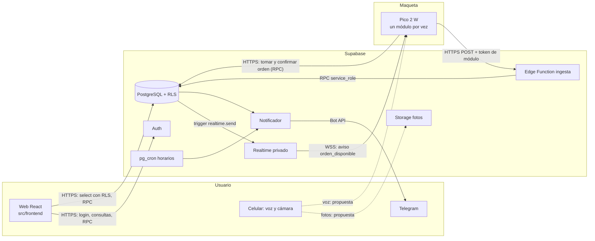
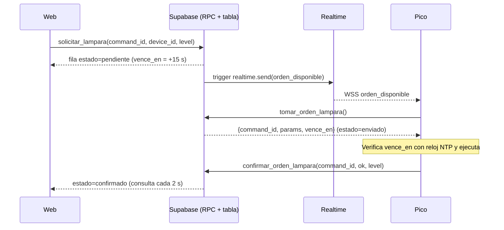
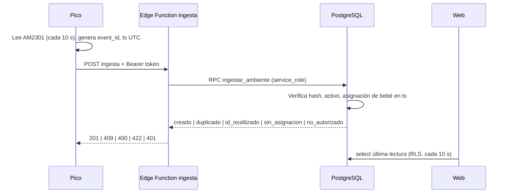
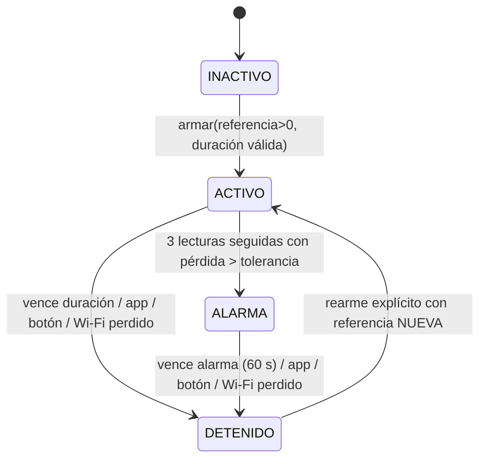
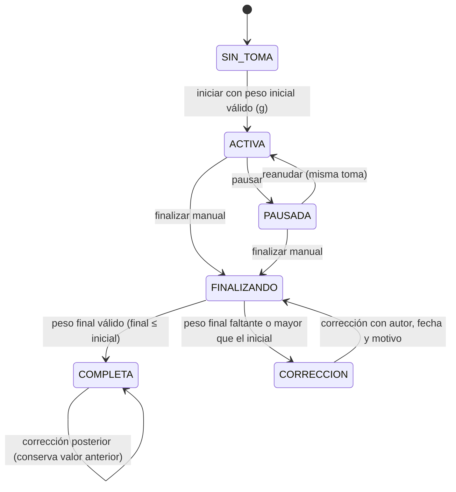

# Arquitectura e interfaces · Cuna Inteligente IoT

**Fase 1 del [plan de ejecución](PLAN-PROYECTO.md) · HU-31 (CA-31.1 a CA-31.4) y HU-32 (CA-32.4).**
Base: rama `development`, commit `386ca9a`. Fecha: 2026-11-17.

Este documento define cómo se relacionan la web, Supabase, el firmware, Telegram, las fotos y la voz. Separa con claridad lo que **ya existe en el código** de lo que es **propuesta de diseño** para las fases 3 a 11. Una propuesta no está implementada ni aprobada por el equipo hasta que se registre en la [matriz](matriz-hu-ca.md) o en `docs/Jira/DecisionesAprobadas.md` (DEC-01 a DEC-13).

Leyenda de estado usada en las tablas:

| Marca | Significado |
|---|---|
| **Existe** | Hay código en el repositorio. No implica verificación contra Supabase real ni hardware. |
| **Parcial** | Existe una parte (por ejemplo, solo firmware, sin web ni backend). |
| **Propuesta** | Diseño de esta fase, sin código. |

## 1. Visión general

Líneas continuas: existen en el código (lámpara y ambiente/movimiento). Líneas punteadas: propuesta.

## 2. Componentes y responsabilidades (CA-31.1)

| Componente | Responsabilidad | Estado | Dónde |
|---|---|---|---|
| **Web** | Único punto de operación para el cuidador: cuentas, bebés, dispositivos, controles, historial, gráficos y exportación. Sitio web, sin aplicación nativa (CA-31.4). Nunca decide el estado de un dispositivo: muestra lo que confirma el backend. | Parcial: login, `/cuna` (ambiente, lámpara y movimiento tras banderas). `/colchon`, `/figuras`, `/historial` son marcadores sin datos. | `src/frontend/` |
| **Supabase Auth** | Cuentas de cuidadores y cuentas de módulo (la Pico se autentica con una cuenta de dispositivo para comandos). Una cuenta no puede ser a la vez cuidador y dispositivo. | Existe | `supabase/migrations/20261111000300_entrega_lampara.sql` |
| **PostgreSQL + RLS** | Fuente de verdad. Los dueños activos leen sus datos; ningún rol de API escribe directamente las lecturas. | Existe para ambiente, movimiento y lámpara | `supabase/migrations/` |
| **Ingesta** (Edge Function) | Recibe eventos de la Pico por HTTPS, valida formato, autentica el módulo por token y escribe mediante RPC exclusiva de `service_role`. Idempotente por `event_id`. | Existe (`ambiente`, `movimiento`) | `supabase/functions/ingesta/` |
| **Realtime** | Aviso push de que hay una orden pendiente; la orden en sí se toma por RPC. Canal privado por módulo. | Existe (lámpara) | `…0300_entrega_lampara.sql` |
| **Notificador + Telegram** | Un aviso por evento y destinatario, con la web cerrada. Vinculación con código de un uso. | Propuesta (fase 4) | `src/backend/Integrations/Telegram/` está vacío |
| **pg_cron** | Ejecuta horarios en `America/Costa_Rica` sin depender de la web. | Propuesta (fase 4) | — |
| **Storage** | Fotos privadas de eventos de habitación, accesibles solo al dueño. Sin audio. | Propuesta (fase 7) | — |
| **Firmware (Pico 2 W)** | Lee sensores, ejecuta comandos, confirma físicamente y calcula localmente las alarmas del colchón. Un solo módulo por vez (`MODULO`). | Parcial: ambiente, movimiento y lámpara conectados; figuras, colchón y audio solo locales | `src/firmware/pico/` |
| **Fotos** | La maqueta admite un teléfono como cámara. La cámara no graba video. | Propuesta (fase 7) | — |
| **Voz en vivo** | Un sentido: celular → altavoz de la cuna. Sin almacenamiento. | Propuesta (fase 5). Riesgo de arquitectura: probar primero (fase 2). | — |

`src/backend/` contiene solo carpetas vacías (`.gitkeep`). El backend del proyecto vive en `supabase/`; no se prevé un servidor propio.

## 3. Servicios, protocolos y esquema (CA-32.4)

| Enlace | Protocolo | Autenticación | Estado |
|---|---|---|---|
| Web → Supabase | HTTPS (Data API, RPC, Auth) | Sesión de usuario + clave publicable. RLS limita las filas. | Existe |
| Pico → Ingesta | HTTPS POST `/functions/v1/ingesta`, TLS con raíz fijada (`gts-root-r4.der`) | `Authorization: Bearer <token 64 hex>`; la base guarda solo el SHA-256 | Existe |
| Supabase → Pico (aviso) | WSS `/realtime/v1/websocket`, tópico privado `realtime:lampara:<id>`, latido cada 20 s | Sesión de la cuenta de dispositivo | Existe (lámpara) |
| Pico → Supabase (orden) | HTTPS RPC `tomar_orden_lampara`, `confirmar_orden_lampara` | Sesión de la cuenta de dispositivo | Existe (lámpara) |
| Notificador → Telegram | HTTPS Bot API | Token del bot en secretos de Supabase | Propuesta |
| Celular → Pico (voz) | Por definir (WSS por Realtime o conexión directa). Depende de la prueba de la fase 2. | — | Propuesta |

**Esquema actual** (`supabase/migrations/`, 4 archivos):

| Objeto | Contenido | Acceso |
|---|---|---|
| `cuna_private.bebes(id, nombre)` | Bebés | Ningún rol de API |
| `cuna_private.dispositivos(id, token_sha256, activo)` | Módulos lógicos y hash de su credencial | Ningún rol de API |
| `cuna_private.duenos_dispositivo(dispositivo_id, usuario_id, activo)` | Dueños por dispositivo | Ningún rol de API |
| `cuna_private.asignaciones_bebe(dispositivo_id, desde, bebe_id null)` | Historial de asignación módulo → bebé | Ningún rol de API |
| `cuna_private.cuentas_dispositivo(usuario_id, device_id, activo)` | Cuentas de módulo | Ningún rol de API |
| `public.lecturas_ambiente(event_id PK, device_id, bebe_id, ts, recibido_en, temperatura_c, humedad_pct)` | Lecturas AM2301 | `select` de dueños activos |
| `public.eventos_movimiento(event_id PK, device_id, bebe_id, ts, recibido_en)` | Detecciones PIR | `select` de dueños activos |
| `public.ordenes_lampara(command_id PK, device_id, command, solicitante_id, nivel, creado_en, vence_en, estado, entregado_en, confirmado_en, nivel_confirmado, error)` | Órdenes de lámpara | `select` de dueños activos |
| RPC `ingestar_ambiente`, `ingestar_movimiento` | Escritura de eventos | Solo `service_role` |
| RPC `solicitar_lampara`, `tomar_orden_lampara`, `confirmar_orden_lampara` | Ciclo de orden | `authenticated` (web y cuenta de dispositivo) |

**Esquema propuesto** (fases 3 a 10; los nombres son provisionales):

| Objeto | Motivo | Fase |
|---|---|---|
| RPC de bebés, dispositivos, invitaciones y reasignación; restricción del último dueño | HU-02 a HU-05 | 3 |
| `destinatarios_telegram`, `codigos_vinculacion` (un uso), `avisos(event_id, destinatario_id, intentos, estado)` | HU-06, HU-07 | 4 |
| `horarios` (por módulo, hora local, zona fija `America/Costa_Rica`) | HU-07, HU-08, HU-13, HU-17, HU-22 | 4 a 9 |
| Generalizar `ordenes_lampara` en una tabla de órdenes por módulo con el mismo ciclo `pendiente → enviado → confirmado/error` | HU-11, HU-13, HU-14, HU-16, HU-19 | 5 a 8 |
| `eventos` unificado (tipo, descripción, valor, unidad, bebé, dispositivo) como base de historial y exportación | HU-24 a HU-27 | 10 |
| `tomas`, `pausas_toma`, `correcciones_toma` | HU-20, HU-21 | 9 |
| `fotos` (ruta en Storage, evento, bebé) | HU-18 | 7 |
| `limites_ambiente`, `limites_biberon` con restricción mínimo < máximo | HU-10, HU-23 | 5 y 9 |

## 4. Reglas transversales (CA-31.2)

**Identidad del dispositivo.** Hay dos niveles: el módulo lógico (`cuna-ambiente-01`, `cuna-movimiento-01`, `cuna-lampara-01`; los dos últimos con patrón estricto `cuna-<módulo>-NN`) y la placa física (`pico-sprint3-01`, reservada). Los permisos y la asociación al bebé se asignan al módulo lógico. La ingesta autentica con un token por módulo; los comandos usan una cuenta de dispositivo por módulo. La ingesta rechaza con 401 un `device_id` con prefijo de otro módulo.

**Bebé asociado en el instante del evento.** La ingesta busca la fila de `asignaciones_bebe` más reciente con `desde <= ts`. Una fila con `bebe_id` nulo cierra la asignación. Sin bebé en `ts`, un evento nuevo recibe `422 sin_asignacion`. La fila guardada conserva su `bebe_id` original aunque el módulo se reasigne después (HU-05, CA-24.4).

**Fecha y hora.** La Pico envía `ts` en UTC, ISO 8601 con sufijo `Z` y hasta tres decimales, tomado con reloj sincronizado por NTP. Si no hay hora confiable, omite el envío. El servidor guarda además `recibido_en`. La web y la exportación presentan siempre en `America/Costa_Rica` (CA-22.4); el almacenamiento es UTC. Los horarios de recordatorios se definen en hora local de `America/Costa_Rica`, que no tiene horario de verano.

**Unidades.** °C, % HR y gramos (DEC-07). La unidad forma parte del contrato, no de la fila de la base: la web y la exportación la adjuntan según el tipo.

**Identidad de evento e idempotencia.** Cada evento lleva un `event_id` UUID v4 generado en el origen. Un reintento conserva `event_id`, hora y datos. Reenviar el mismo `event_id` con los mismos datos da `409` y no crea otra fila. Reutilizar el `event_id` con datos distintos da `400 id_reutilizado`. Dos eventos distintos con la misma hora tienen `event_id` distintos y se guardan ambos (CA-24.5, DEC-13). Los comandos usan `command_id` UUID con la misma regla.

**Asociaciones históricas.** Retirar un dueño o reasignar un módulo no borra registros. Ningún flujo del producto elimina historial (CA-24.7). Borrar la cuenta solicitante conserva la orden original.

**Errores.** Respuesta uniforme `{codigo, mensaje, reintentable}`. Un fallo de validación no es reintentable; un fallo temporal sí.

## 5. Contratos de eventos y comandos

### 5.1 Eventos de dispositivo hacia el backend

| Evento (`tipo`) | Productor → consumidor | Transporte | Datos | Estado | Contrato |
|---|---|---|---|---|---|
| `ambiente` | Pico (cuna) → Ingesta → `lecturas_ambiente` → web | HTTPS POST | `temperatura_c`, `humedad_pct` cada 10 s | Existe | `src/shared/contracts/ambiente.md` |
| `movimiento` | Pico (cuna, PIR) → Ingesta → `eventos_movimiento` → web | HTTPS POST | `{}`; solo si `MONITOREO_MOVIMIENTO_HABILITADO` | Existe, sin aviso Telegram | `src/shared/contracts/movimiento.md` |
| `alarma_colchon` | Pico (colchón) → Ingesta → eventos → Notificador | HTTPS POST | `referencia_g`, `ultimo_peso_g`, `motivo` | Propuesta | — |
| `puerta`, `movimiento_habitacion` | Pico (habitación) → Ingesta → eventos + solicitud de foto | HTTPS POST | `{}` | Propuesta | — |
| `foto` | Celular o cámara → Storage → fila `fotos` | HTTPS | ruta, `event_id` del evento de origen | Propuesta | — |
| `juego` | Pico (juego) → Ingesta | HTTPS POST | `objetivo`, `acierto` | Propuesta | — |
| `peso_toma`, `temperatura_biberon` | Pico (alimentación) → Ingesta | HTTPS POST | gramos; °C | Propuesta | — |

Las lecturas de peso del colchón se miden cada segundo **solo en la Pico**. No se envían ni se registran como movimientos (CA-14.4). Solo la alarma sale como evento.

### 5.2 Comandos de la web hacia el dispositivo

| Comando | Productor → consumidor | Confirmación física | Estado |
|---|---|---|---|
| `lamp_set` (`level` 0–100) | Web `solicitar_lampara` → Realtime → Pico | `confirmar_orden_lampara` con `nivel_confirmado` | Existe. Contrato: `src/shared/contracts/lampara.md` |
| `led_set`, `led_all`, `led_sequence` (`step_s ≥ 2`), `led_stop` | Web → Pico (figuras) | Ack `{command_id, command, ok, result|error}` | Firmware local (`comandos.py`). Sin canal de red. |
| `audio_play`, `audio_stop`, `audio_status` | Web → Pico (cuna) | Igual | Firmware local. Un solo tono, sin catálogo. |
| `mattress_tare`, `mattress_calibrate`, `mattress_arm`, `mattress_rearm`, `mattress_stop`, `mattress_status` | Web → Pico (colchón) | Igual | Firmware local. Sin canal de red. |
| `get_status` | Web → Pico (todos los módulos) | Igual | Firmware local. |

Formato local del firmware (`src/firmware/pico/common/utilities/comandos.py`): entrada `{command_id, command, params}`, salida `{command_id, command, ok, result|error}`. Un comando de otro módulo se rechaza con `comando_de_otro_modulo:<módulo>`.

Ciclo de una orden (existe para la lámpara; propuesta generalizarlo):

Reglas del ciclo: la orden vence a los 15 s; una orden vencida no se ejecuta; la entrega es como máximo una vez; confirmar dos veces con el mismo resultado se acepta, con resultado distinto da `23505 confirmacion_distinta`; si se pierde la conexión, la Pico descarta órdenes pendientes y apaga la lámpara. La web no cambia el nivel mostrado hasta recibir la confirmación (sin estado optimista).

### 5.3 Flujo de ingesta

| HTTP | Código | Acción del firmware |
|---|---|---|
| 201 | `recibido` | Dar por guardado. |
| 409 | `evento_duplicado` | Dar por confirmado. |
| 400, 401, 405, 413, 422 | `evento_invalido`, `id_reutilizado`, `no_autorizado`, `sin_asignacion` | No reintentar; corregir. |
| 503 | `ingesta_no_disponible` (`reintentable: true`) | Un reintento a los 250 ms, dentro de la ventana de 10 s. |

El firmware conserva a lo sumo un evento pendiente por tipo y lo descarta si cae el Wi-Fi.

## 6. Estados (CA-31.3)

### 6.1 Monitoreo del colchón y alarma

Existe en firmware: `src/firmware/pico/colchon/monitoreo.py` (estados, filtro de 3 lecturas y alarma) y `peso.py` (tara y calibración), con envío de eventos y recepción de órdenes por `common/communication/nube.py`. Los parámetros por defecto son tolerancia 10 %, 3 lecturas consecutivas, 1 lectura por segundo y alarma de 60 s (`ALARMA_S`). La web de `/colchon` lee esos eventos (`eventos_colchon`) y pide órdenes (`ordenes_colchon`); falta probarlo con la Pico y Supabase reales.

| Regla | Detalle |
|---|---|
| Armar | Exige calibración, referencia numérica positiva y duración positiva. Con monitoreo en curso se rechaza. |
| Pérdida | `(referencia − lectura) × 100 > tolerancia × referencia`. Con 1000 g y 10 %: tres lecturas de 890 g disparan; tres de 900 g no; 890 g seguido de 1000 g reinicia la cuenta. Una lectura inválida también reinicia la cuenta. |
| Sin monitoreo | No hay alarma (CA-15.3). |
| Después de cualquier parada | El monitoreo queda detenido. Solo un rearme explícito, con una referencia capturada de nuevo, vuelve a activarlo. |
| Wi-Fi | Perderlo con monitoreo activo detiene y exige rearme. No se arma sin Wi-Fi. |
| Botón físico | Solo detiene. Nunca arma. Antirrebote por nivel estable. |
| Pendiente | Tolerancia y duración de alarma configurables desde la web, aviso a Telegram y persistencia del evento. |

### 6.2 Toma de alimentación (propuesta; DEC-01, DEC-02, DEC-13)

- Sin peso inicial válido no se inicia y se indica que debe usarse el mismo recipiente al final.
- Duración activa = fin − inicio − suma de pausas. Ejemplo del PDF: 08:00 a 08:15 con pausa 08:05 a 08:07 da 13 minutos.
- Cantidad ingerida = peso inicial − peso final (200 g y 150 g dan 50 g). Nunca negativa.
- Devolver el biberón permite pesar pero no cierra la toma. El cierre automático está fuera del alcance (CA-21.5).
- Toda corrección guarda valor anterior, valor nuevo, autor, fecha y motivo.
- Solo hay una toma abierta por bebé y módulo.

### 6.3 Episodios fuera de rango (propuesta; DEC-13, CA-07.5)

Un episodio comienza en la primera lectura fuera de `[mínimo, máximo]` y termina cuando una lectura vuelve al rango. Se emite un aviso al comenzar. Las lecturas siguientes fuera de rango no generan más avisos. Una nueva salida tras volver al rango inicia otro episodio. Los límites exigen mínimo < máximo; si no, no se guarda el cambio y se conserva la configuración anterior.

### 6.4 Recuperación y horarios tras un corte (propuesta; DEC-04, DEC-10)

Regla general: tras un corte de energía o de internet se conservan datos y configuración, no se reconstruyen lecturas, el hueco queda visible, los recordatorios vencidos se omiten y los futuros conservan su programación. La web distingue «monitoreo detenido» de «monitoreo activo» y no presenta lecturas viejas como nuevas (el estado «Desactualizado» a los 30 s ya existe en `/cuna`).

| Módulo | Comportamiento tras un corte | Origen |
|---|---|---|
| Cuna: ambiente | Se retoman las lecturas al reconectar. Los 10 s no se recuperan. Se descarta la lectura pendiente. | Existe (firmware) |
| Cuna: movimiento | Se retoma al reconectar. Las ventanas programadas se evalúan en el servidor y rigen desde su próximo inicio. Si el corte termina dentro de una ventana, el monitoreo sigue detenido hasta el próximo inicio o una activación manual. | Propuesta a confirmar |
| Cuna: lámpara | Existe: la Pico descarta órdenes pendientes y apaga la lámpara. No se reanuda sola. | Existe |
| Figuras LED | Mismo criterio que la lámpara: apagadas y sin reanudación automática. Un horario solo actúa en su próximo límite futuro. | Propuesta a confirmar |
| Colchón | Monitoreo detenido, rearme manual con referencia nueva. | Existe (firmware, DEC-10) |
| Habitación | Mismo criterio que el movimiento de cuna. | Propuesta a confirmar |
| Juego | Apagado; se reinicia con acción del adulto. | Propuesta |
| Alimentación | La toma abierta se conserva abierta y se marca el hueco. El cierre sigue siendo manual. | Propuesta; decidir si el hueco cuenta en la duración |
| Recordatorios | Los vencidos durante el corte se omiten (no se envían al recuperar). El siguiente horario futuro se ejecuta con normalidad. | Propuesta (DEC-04, DEC-10) |

### 6.5 Horarios (propuesta; DEC-04, CA-22.3)

Un planificador en Supabase (pg_cron) evalúa cada minuto los horarios en `America/Costa_Rica`, sin depender de que la web esté abierta. Programar 08:00 y 11:00 genera un recordatorio en esas horas, todos los días, y ninguno en horas intermedias. Se envía como máximo un aviso por hora programada y destinatario. Cada intento queda registrado por evento y destinatario, con sus reintentos y fallos.

## 7. Interfaz web (CA-31.4)

La interfaz es un sitio web gratuito (React + Vite) que debe operar los dispositivos y contener los controles de HU-01 a HU-29. No se exige aplicación nativa.

| Sección | Controles requeridos | Estado |
|---|---|---|
| Cuentas y sesión | Registro, inicio y cierre de sesión | Parcial: inicio y cierre. Falta registro. |
| Bebés y dispositivos | Bebés, asociar módulos, administrar dueños, reasignar | Pendiente (fase 3) |
| Destinatarios de Telegram | Alta con código, baja | Pendiente (fase 4) |
| Cuna | Ambiente, límites, movimiento, lámpara, audio, voz | Parcial: ambiente, lámpara y movimiento (tras banderas `VITE_*_HABILITADO`) |
| Figuras | Encender, apagar, horario, intervalo ≥ 2 s | Pendiente: seis indicadores neutros sin controles |
| Colchón | Activar, duración, tolerancia, detener, rearmar | Pendiente: marcador sin datos |
| Habitación | Sensores, horario, fotos | Pendiente |
| Juego | Encender y apagar | Pendiente |
| Alimentación | Toma, pausa, cierre, corrección, horarios, límites | Pendiente |
| Historial, gráficos, exportación | Filtros, resumen nocturno, histogramas, líneas, `.xlsx` | Pendiente: marcador `/historial` |

Reglas permanentes de la web (de `src/frontend/CLAUDE.md` y `CLAUDE.md`): no mostrar mediciones inventadas ni controles que aparenten operar hardware real sin integración real; el estado de un comando es el que confirma el backend; todo cambio de contrato debe coincidir con `comandos.py`. Los stubs de `src/frontend/src/services/noConfigurado.ts` devuelven «Backend no configurado» y no deben leerse como funcionalidad.

## 8. Decisiones abiertas para el equipo

1. Transporte de la voz en vivo (Realtime o conexión directa) y viabilidad en la Pico. Probar antes de fijar el diseño: prueba P2 de [`protocolo-banco.md`](protocolo-banco.md), pendiente de ejecución.
2. Si una toma interrumpida por un corte cuenta el hueco en la duración activa.
3. Comportamiento de ventanas de monitoreo y horarios de figuras cuando el corte termina dentro de la ventana (propuesta: no reanudar hasta el siguiente inicio).
4. Cómo generalizar `ordenes_lampara` a todos los módulos (una tabla con `command` y `params` o una tabla por módulo).
5. Matriz de navegadores y dispositivos para HU-35 (CA-35.3).
6. Mecanismo de fotos: carga desde el celular a Storage o captura por una cámara del módulo. Prueba P3 de [`protocolo-banco.md`](protocolo-banco.md), pendiente de ejecución.
7. Definir los identificadores de módulo lógico futuros (por ejemplo `cuna-colchon-NN`, `cuna-figuras-NN`). Hoy `ingesta` exige el patrón `cuna-movimiento-NN` para movimiento y `cuna-lampara-NN` para las órdenes de lámpara (en la base). Para ambiente acepta cualquier identificador con el formato general `[a-z0-9][a-z0-9_-]{0,63}`, salvo los prefijos `cuna-movimiento-` y `cuna-lampara-`, que rechaza con 401 (`supabase/functions/ingesta/handler.ts:21-23`).

## 9. Fuentes

- Especificación: `docs/Sprint1/EntregableSprint1.pdf` (HU-31, CA-31.1 a CA-31.4; HU-32, CA-32.4).
- Decisiones: `docs/Jira/DecisionesAprobadas.md` (DEC-01 a DEC-13).
- Contratos: `src/shared/contracts/ambiente.md`, `lampara.md`, `movimiento.md`.
- Código: `supabase/migrations/`, `supabase/functions/ingesta/`, `src/firmware/pico/`, `src/frontend/`.
