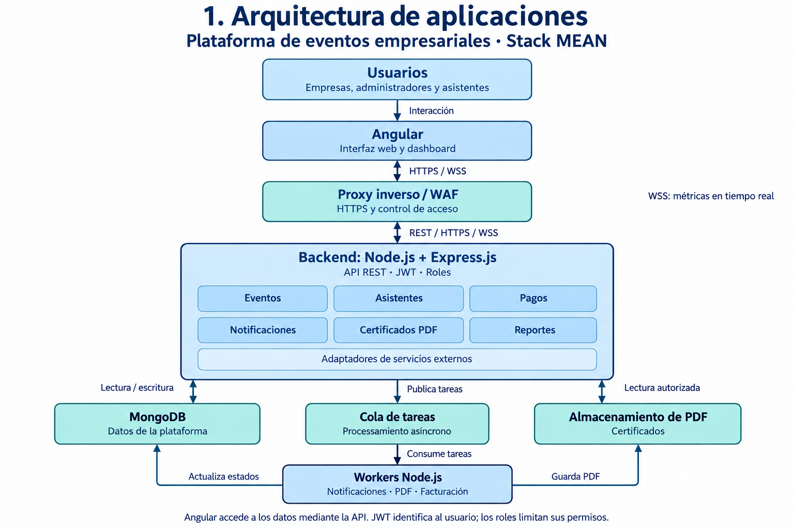
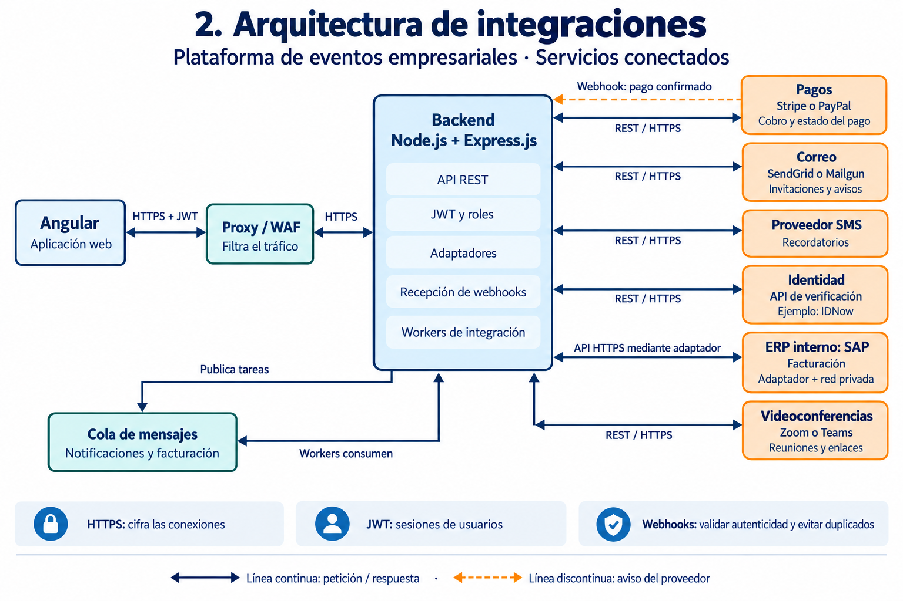

# Arquitecturas de la plataforma de eventos empresariales

Propuesta basada en T5. Arquitectura.pdf. El documento proporciona los requisitos; la cola, los workers, el almacenamiento de PDF, el proxy y WSS son decisiones de diseño para cubrirlos. Las marcas mencionadas son alternativas de proveedores, no servicios que deban utilizarse todos simultáneamente.

## 1. Arquitectura de aplicaciones

La plataforma utiliza el stack MEAN. Angular presenta la interfaz; Node.js ejecuta el backend; Express.js organiza sus rutas y la API; MongoDB almacena los datos. Se propone un backend modular con gestión de eventos, asistentes, pagos, notificaciones, certificados y reportes.

Los usuarios interactúan con Angular para crear eventos, inscribirse y consultar información. Angular envía solicitudes al proxy inverso mediante HTTPS. El proxy/WAF filtra el tráfico y lo dirige a la API de Express.js. La API valida el JWT, los permisos por rol y el acceso a los datos de cada empresa antes de ejecutar las operaciones.

El backend consulta y actualiza MongoDB para guardar eventos, inscripciones, estados de pagos, historial y referencias de certificados. Angular obtiene esos datos mediante la API. Para las métricas en tiempo real, el backend envía actualizaciones por WSS (WebSocket seguro), también a través del proxy.

El backend publica en una cola las tareas que pueden ejecutarse en segundo plano. Los workers Node.js consumen esas tareas, envían notificaciones, generan certificados y coordinan la facturación mediante los adaptadores externos. Después actualizan en MongoDB el resultado del trabajo.

Los workers guardan los certificados en un almacenamiento de archivos PDF. El backend comprueba los permisos antes de entregar el archivo solicitado al usuario. MongoDB conserva sus metadatos y ubicación, mientras el almacenamiento mantiene el contenido del certificado.

## 2. Arquitectura de integraciones

El backend centraliza la comunicación con los proveedores mediante adaptadores. Las conexiones REST sobre HTTPS representan solicitudes y respuestas; la flecha discontinua representa una notificación del proveedor por webhook. Las interfaces y credenciales concretas se ajustan al proveedor seleccionado.

| Conexión | Información intercambiada y propósito |
| --- | --- |
| Backend y pasarela de pagos | El backend solicita un cobro y recibe su identificador o estado. La pasarela comunica el resultado por webhook; el backend valida su autenticidad y actualiza la inscripción y el pago. |
| Backend y servicio de correo | Envía destinatarios, plantillas y datos del evento para entregar invitaciones, confirmaciones y avisos. El proveedor devuelve el resultado de la solicitud. |
| Backend y proveedor SMS | Envía números de teléfono y mensajes para recordatorios y notificaciones. El proveedor devuelve el estado de la solicitud. |
| Backend y API de identidad | Inicia la verificación del asistente y recibe el resultado para aplicar las reglas de registro del evento. |
| Backend y SAP | Un adaptador transmite los datos necesarios para facturar y recibe la referencia y el estado de la factura. Se propone acceso por una interfaz HTTPS autorizada y una red privada; la interfaz exacta depende del SAP disponible. |
| Backend y Zoom o Teams | Solicita la creación o actualización de una reunión y recibe sus identificadores y enlaces, que se vinculan al evento y se distribuyen a los asistentes autorizados. |
| Backend y cola | El backend publica trabajos; sus workers obtienen tareas pendientes y las ejecutan. La cola permite reintentos y evita que las notificaciones o la facturación retrasen la respuesta al usuario. |

HTTPS cifra las comunicaciones y WSS protege las actualizaciones en tiempo real. El JWT identifica la sesión de usuario y el backend aplica los permisos por rol; las integraciones externas usan las credenciales que requiera cada proveedor, guardadas en el servidor. El proxy/WAF funciona como filtro de entrada y MongoDB y la cola permanecen en la red interna. Los webhooks deben validarse y procesarse de forma idempotente: recibir dos veces el mismo aviso no debe duplicar pagos, inscripciones ni facturas.

Como ejemplo del flujo completo, una inscripción inicia el cobro en la pasarela. Cuando llega el webhook válido que confirma el pago, el backend actualiza MongoDB y publica tareas para enviar la confirmación y registrar la factura en SAP. El certificado se genera después de verificar que el asistente cumple los requisitos de participación.

## Archivos

- 01-arquitectura-aplicaciones.png
- 02-arquitectura-integraciones.png
- instrucciones-imagenes.txt: prompts originales y correcciones utilizadas con la herramienta integrada de generación de imágenes.
